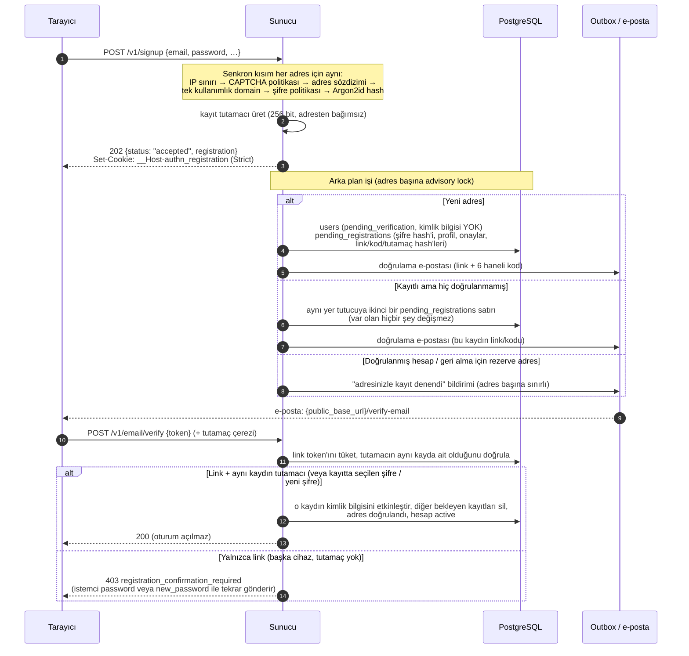
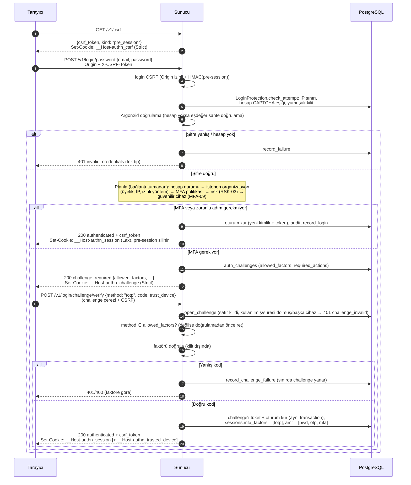
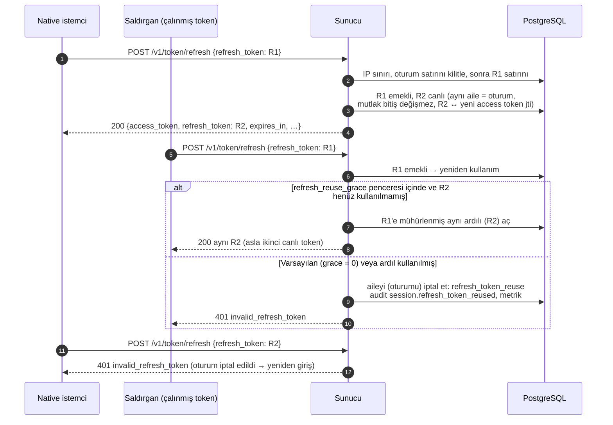
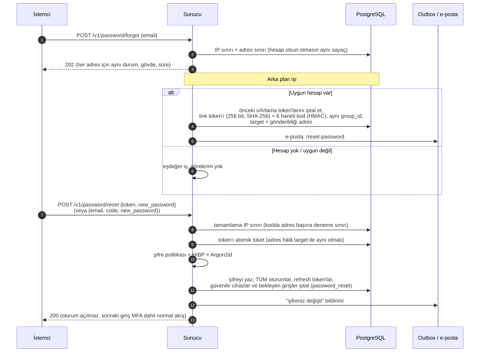
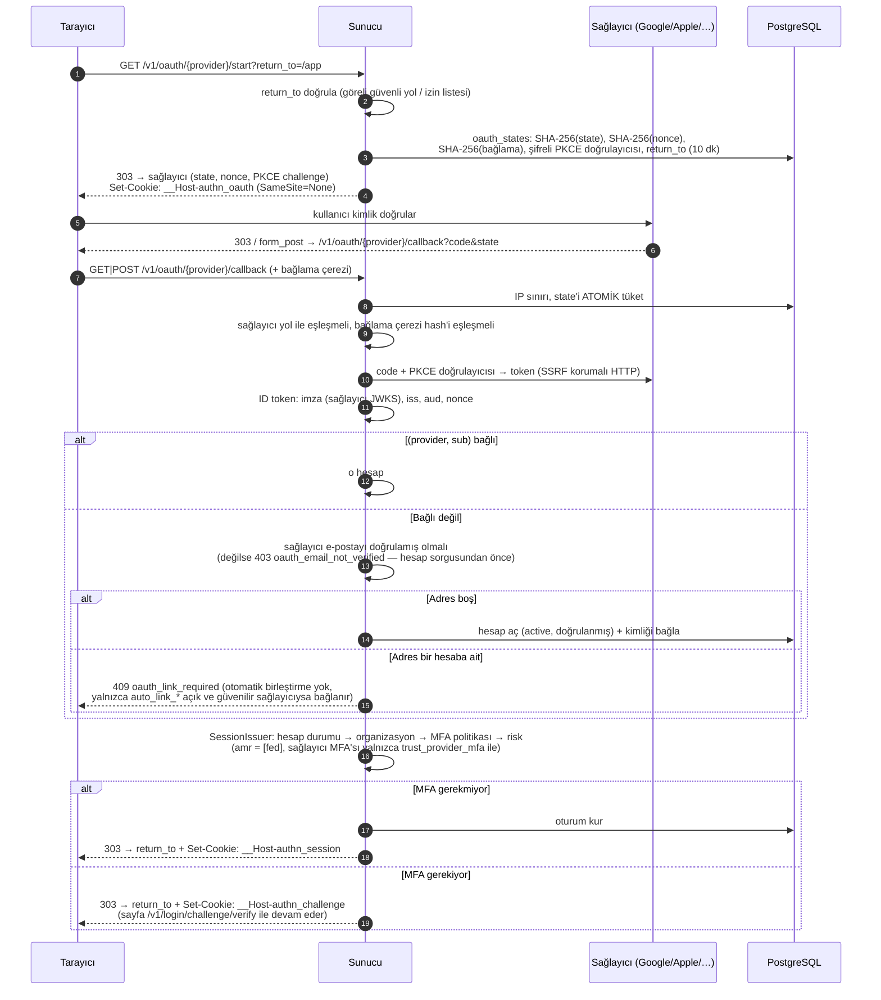
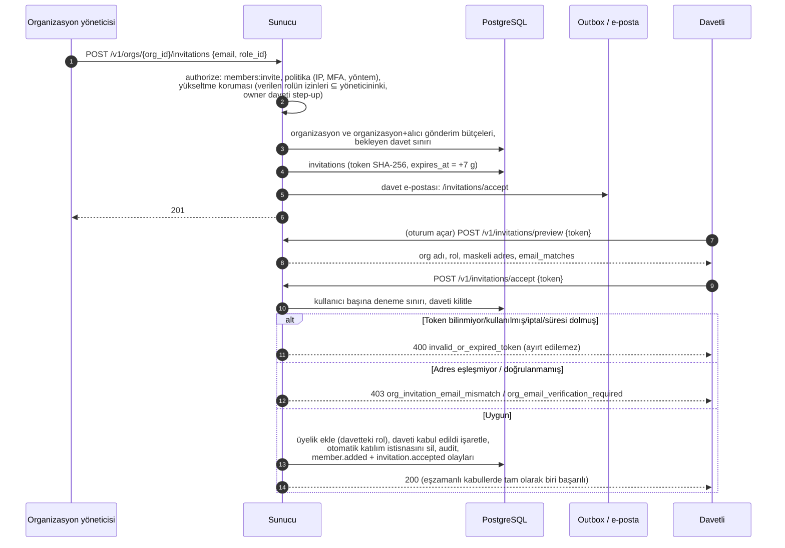

# Akış diyagramları (DOC-02)

Başlıca kimlik doğrulama akışlarının sıra diyagramları. Her diyagram kodla doğrulanmıştır (dosya yolları her bölümün başında). Bileşen ve veri modeli diyagramları: [`overview.md`](overview.md). İstek/yanıt ayrıntıları: [`docs/api/`](../api/README.md).

Kısaltmalar: **T** = tarayıcı / istemci, **S** = `rust-authentication` sunucusu, **DB** = PostgreSQL, **Q** = outbox (aynı transaction'da yazılır, arka plan işçisi teslim eder).

## 1. Kayıt ve e-posta doğrulama (ACC-01, ACC-02, ACC-04, ADR 0002)

Kaynak: `crates/authn-account/src/service/{signup,registration,verification}.rs`, ADR [0002](adr/0002-registration-pre-hijacking.md).

Kod yolu (mobil): `POST /v1/email/verify {code, registration}` — kod yalnızca o kaydın tutamacıyla geçerlidir; tutamaçsız kod `invalid_code`.

## 2. Giriş + MFA (web) (SES-01, SES-02, SES-04, MFA-*)

Kaynak: `crates/authn-session/src/login/{routes,password,pipeline,challenge}.rs`, `crates/authn-session/src/{csrf,cookies}.rs`, `crates/authn-protect/src/login.rs`.

Native istemcide aynı akış `X-Authn-Client: native` ile çalışır: CSRF adımları yoktur, challenge token'ı gövdede döner ve `X-Authn-Challenge` başlığıyla gönderilir, başarıda gövdede `access_token` + `refresh_token` gelir.

## 3. Refresh token rotasyonu ve yeniden kullanım tespiti (SES-05)

Kaynak: `crates/authn-session/src/service/refresh.rs`, `crates/authn-session/src/store/refresh.rs`.

Bilinmeyen, süresi dolmuş, iptal edilmiş ve tekrar kullanılmış token'ların hepsi aynı `401 invalid_refresh_token`'ı alır. Eşzamanlı iki yenilemede satır kilidi sırası (oturum → token) birini kazandırır; diğeri tekrar sayılır.

## 4. Şifre sıfırlama (PWD-07, PWD-08, PWD-09)

Kaynak: `crates/authn-password/src/service/reset.rs`.

## 5. Sosyal giriş (web) (SOC-01 … SOC-05, SOC-09)

Kaynak: `crates/authn-oidc-client/src/{routes,cookies,service/…}.rs`, `crates/authn-session/src/service/issuer.rs`.

Hata olursa `oidc_client.error_redirect` ayarlıysa `303 …?error=<kod>`, değilse JSON hata zarfı. Native akış (`POST /v1/oauth/nonce` → SDK → `POST /v1/oauth/{provider}/native`) state/çerez yerine sunucunun verdiği tek kullanımlık nonce'u tüketir ve token'ları gövdede döner.

## 6. Davet kabulü (ORG-05)

Kaynak: `crates/authn-org/src/service/invitations.rs`, `crates/authn-org/src/authz.rs`.

