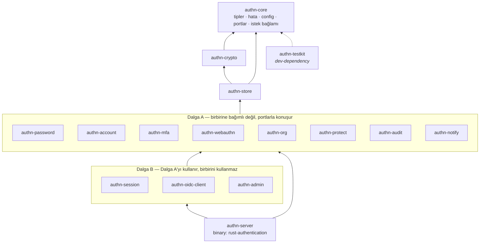
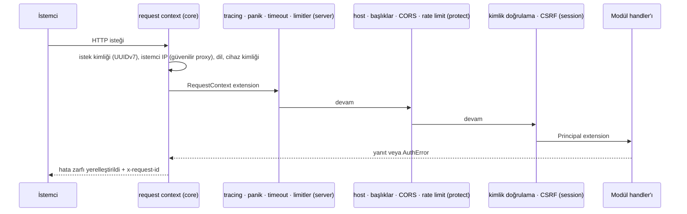

# Mimari genel bakış

`rust-authentication`, B2C web, B2B SaaS ve native mobil uygulamaların ortak kullandığı, Rust ile yazılmış bir kimlik doğrulama sistemidir. Bu belge yapının özetidir; bağlayıcı kurallar [`contracts.md`](contracts.md), gereksinimler [`../spec/requirements.md`](../spec/requirements.md) içindedir.

## Katmanlar ve crate bağımlılık grafiği

- **Hexagonal yapı (ARC-02):** e-posta, SMS, CAPTCHA, saat, risk, DNS, HTTP, oturum kapatma/açma gibi tüm yan etkiler `authn-core::ports` içindeki trait'ler arkasındadır. Uygulamalar sahip modüllerdedir; testlerde `authn-testkit` sahteleri kullanılır.
- **Paralel geliştirme:** Aynı dalgadaki modüller birbirini derleme zamanında görmez; ortak sözleşme yalnızca `authn-core`'dur. Bu sayede her modül diğerleri bitmeden derlenir ve test edilir.
- **Uygulama durumu (ARC-03):** `AppState` yalnızca `authn-server`'dadır. Modüller `router<S>()` + `FromRef<S>` ile servislerini ister.

## İstek yaşam döngüsü

## Veri modeli (Faz 1)

```mermaid
erDiagram
    users ||--o| user_profiles : ""
    users ||--o| password_credentials : ""
    users ||--o{ sessions : ""
    sessions ||--o{ refresh_tokens : "token ailesi"
    users ||--o{ auth_challenges : "bekleyen giriş"
    users ||--o{ one_time_tokens : ""
    users ||--o{ mfa_factors : ""
    users ||--o{ recovery_codes : ""
    users ||--o{ trusted_devices : ""
    users ||--o| webauthn_user_handles : ""
    users ||--o{ webauthn_credentials : ""
    users ||--o{ identities : "sosyal / federe"
    users ||--o{ memberships : ""
    organizations ||--o{ memberships : ""
    roles ||--o{ memberships : ""
    organizations ||--o{ roles : "özel roller"
    roles ||--o{ role_permissions : ""
    organizations ||--o{ invitations : ""
    organizations ||--o{ org_domains : ""
    organizations ||--o| org_policies : ""
    organizations ||--o{ service_accounts : ""
    organizations ||--o{ api_keys : ""
    service_accounts ||--o{ api_keys : ""
    organizations ||--o{ webhook_endpoints : ""
    webhook_endpoints ||--o{ webhook_deliveries : ""
    users ||--o| audit_subjects : "takma ad"
    audit_events ||--o| audit_event_pii : "silinebilir PII"
    users ||--o{ consents : ""
    terms_versions ||--o{ consents : ""
```

Bağımsız tablolar: `outbox` (transactional outbox), `audit_chain_head` / `audit_chain_checkpoints` (hash zinciri), `signing_keys` / `data_encryption_keys` (anahtar yönetimi), `rate_limit_buckets` (UNLOGGED), `captcha_pow_challenges`, `oauth_states`, `webauthn_ceremonies`, `account_deletions`, `known_devices` / `known_networks`, `login_soft_locks`.

Öne çıkan tasarım kararları:

| Konu | Karar |
|------|-------|
| Kimlikler | Uygulamada üretilen UUIDv7; dışa sıralı tamsayı açılmaz |
| Sırlar | Token/kod → 32 baytlık hash; geri dönüştürülebilir sırlar → zarf şifreli `*_ciphertext` |
| Tek kullanımlık token | `one_time_tokens` genel tablo; atomik `UPDATE … WHERE consumed_at IS NULL … RETURNING` |
| Refresh rotasyonu | Oturum = token ailesi; aile başına tek canlı token (kısmi benzersiz indeks); yeniden kullanım → aile iptali |
| Kiracı izolasyonu | `org_id` her kapsamlı tabloda; rol ataması tetikleyicisi ve bileşik FK'lar |
| Audit | Ekleme-yalnızca tetikleyici, hash zinciri, kişisel veri zincir dışında (takma ad + silinebilir PII tablosu) |
| Hesap silme | `users` satırı silinir, kaskadlar tüm modül verisini temizler, audit'te yalnızca bağlantısız takma ad kalır |
| Faz 2 hazırlığı | `identities` (kurumsal SSO), `signing_keys` + JWKS (OIDC sağlayıcısı), `org_domains.sso_required`, `sessions.amr/acr` |

## Konfigürasyon ve çalışma

- Konfigürasyon: TOML + `AUTHN__` ortam değişkenleri, tipli ve doğrulanmış (fail-fast); örnek: [`config/example.toml`](../../config/example.toml).
- Binary alt komutları: `serve`, `migrate`, `check-config`, `create-admin`, `rotate-signing-key`, `rotate-kek` (`reencrypt`), `verify-audit-chain`, `migrate-legacy-hashes`.
- Yerel bağımlılıklar: `docker compose up -d` (PostgreSQL 16, Redis 7, Mailpit).
- Sağlık: `GET /health/live`, `GET /health/ready` (veritabanı + migration durumu). Metrikler ayrı dinleyicide (`server.metrics_bind_addr`).

## Lisans politikası

Yalnızca ticari kullanımı kısıtlamayan izin verici lisanslar (LIC-01; `deny.toml`). Tek onaylı istisna `webauthn-rs` ailesi (MPL-2.0, crate bazında). Ayrıntılar ve gerekçeli advisory istisnaları için `contracts.md` §14.
