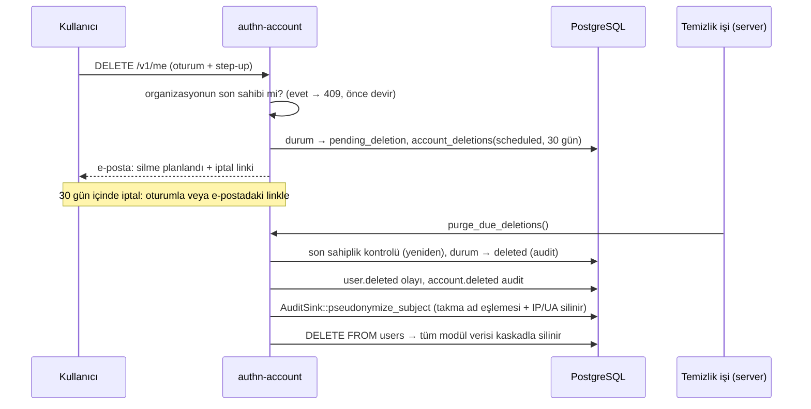

# KVKK / GDPR uyum notları

> Sahip: `authn-account` (DOC-07). Bu belge hukuki görüş değildir; `rust-authentication`'ı işleten kuruluşun (veri sorumlusu) kendi kişisel veri işleme envanterini, aydınlatma metnini ve saklama-imha politikasını hazırlarken kullanacağı teknik dayanaktır. Kanun maddeleri: 6698 sayılı KVKK, AB Genel Veri Koruma Tüzüğü (GDPR, 2016/679).

İçindekiler: 1. Roller ve kapsam · 2. Veri envanteri (tablo bazında) · 3. Saklama süreleri · 4. Silme akışı · 5. Dışa aktarma akışı · 6. Onay kayıtları · 7. Yurt dışına aktarım ve üçüncü taraflar · 8. Güvenlik önlemleri · 9. NIST SP 800-63B notları · 10. İşletmeci kontrol listesi

---

## 1. Roller ve kapsam

| Konu | Not |
|------|-----|
| Veri sorumlusu | Sistemi kendi kullanıcıları için işleten kuruluş (KVKK md. 3, GDPR art. 4(7)). B2B senaryosunda müşteri organizasyonları kendi üyeleri için ayrıca veri sorumlusu olabilir; sözleşmede tanımlanmalıdır. |
| Veri işleyen | Barındırma, e-posta/SMS sağlayıcısı, CAPTCHA sağlayıcısı gibi dış hizmetler (bkz. §7). |
| İlgili kişi | Hesap sahipleri, davet edilen e-posta adresleri, kayıt denemesi yapılan adreslerin sahipleri. |
| Hukuki sebep (öneri) | Kimlik doğrulama ve hesap yönetimi: sözleşmenin ifası (KVKK md. 5/2-c, GDPR art. 6(1)(b)). Güvenlik kayıtları, rate limit, risk sinyalleri: meşru menfaat / hukuki yükümlülük (KVKK md. 5/2-ç, f; GDPR art. 6(1)(c), (f)). Onay (açık rıza) **kimlik doğrulama için gerekli değildir**; kullanım şartları ve gizlilik politikasının kabulü ACC-11 ile ispat amacıyla kaydedilir. |
| Özel nitelikli veri | Sistem özel nitelikli kişisel veri (sağlık, biyometri vb.) **işlemez**. Passkey (WebAuthn) biyometrik doğrulamayı cihazda yapar; sunucuya yalnızca açık anahtar gelir. |
| Veri minimizasyonu | Ad-soyad zorunlu değildir (yalnızca isteğe bağlı görünen ad). Access token'larda e-posta/ad yoktur (SES-08). Domain olayları (webhook) yalnızca kullanıcı kimliği taşır. |

---

## 2. Veri envanteri (tablo bazında)

Kaynak: `migrations/`. "Kişisel veri" sütunu doğrudan veya dolaylı (kullanıcı kimliği ile bağlanabilen) alanları listeler. "Silme" sütunu hesap silindiğinde (ACC-09) ne olduğunu belirtir: **kaskad** = `users` satırı silinince `ON DELETE CASCADE` ile silinir; **NULL** = `ON DELETE SET NULL` ile bağ koparılır.

### 2.1 Hesap ve kimlik bilgileri

| Tablo | Kişisel veri | Amaç | Silme |
|-------|--------------|------|-------|
| `users` | e-posta (kanonik ve küçük harfli biçim), doğrulama zamanı, hesap durumu ve nedeni, son giriş zamanı, oluşturulma zamanı | Hesabın kendisi, giriş, iletişim | Satır silinir (ACC-09 tamamlanınca / doğrulanmamış hesap temizliği ACC-05) |
| `user_profiles` | görünen ad, dil, saat dilimi | Kişiselleştirme, bildirim dili | kaskad |
| `password_credentials` | şifre hash'i (Argon2id + pepper; geri döndürülemez), değişiklik zamanı | Şifreyle giriş | kaskad |
| `terms_versions` | — (belge sürümleri; kişisel veri yok) | ACC-11 | silinmez (kişisel değil) |
| `consents` | kabul edilen belge sürümü, kabul zamanı, **IP adresi**, **user-agent** | ACC-11 ispat yükü | kaskad |
| `account_deletions` | kullanıcı kimliği (UUID), talep/plan/tamamlanma zamanları, önceki durum | Silme sürecinin yürütülmesi ve **silmenin ispatı** | `users` silindiğinde kalır; içinde e-posta, ad, IP **yoktur** — yalnızca artık hiçbir kayda bağlanamayan rastgele UUID. Bkz. §3 |
| `email_reservations` | e-posta (küçük harfli), kullanıcı kimliği, rezervasyon bitişi | ACC-07: e-posta değişikliğinden sonra eski adresin geri alma süresince başkasınca alınmasını önlemek | kaskad; süresi dolunca temizlik işiyle silinir |
| `one_time_tokens` | kullanıcı kimliği, hedef e-posta (e-posta değişikliğinde), talep eden **IP**; token/kodun yalnızca hash'i | Doğrulama, sıfırlama, magic link, iptal linkleri | kaskad; süresi dolanlar temizlik işiyle silinir (OPS-06) |
| `identities` | sosyal/federe sağlayıcı kimliği (`subject`), sağlayıcının verdiği e-posta ve ad, (yapılandırılırsa) zarf şifreli sağlayıcı token'ları | Sosyal giriş (SOC-*) | kaskad |
| `oauth_states` | kullanıcı kimliği (bağlama akışında), dönüş adresi; state/nonce hash'leri | OIDC akışı (10 dk) | kaskad; süresi dolunca temizlenir |

### 2.2 Oturumlar ve giriş

| Tablo | Kişisel veri | Amaç | Silme |
|-------|--------------|------|-------|
| `sessions` | kullanıcı kimliği, cihaz kimliği ve adı, **user-agent**, oluşturma ve son görülme **IP'si**, zamanlar, AMR | Oturum yönetimi, "oturumlarım" listesi (SES-11) | kaskad; süresi dolan oturumlar temizlik işiyle silinir |
| `refresh_tokens` | token hash'i, rotasyon zinciri (oturuma bağlı) | Mobil token rotasyonu (SES-05) | kaskad (oturum üzerinden) |
| `auth_challenges` | kullanıcı kimliği, **IP**, **user-agent**, cihaz kimliği, risk seviyesi | MFA / zorunlu adım challenge'ları (5 dk) | kaskad; süresi dolunca temizlenir |
| `trusted_devices` | cihaz adı, **user-agent**, oluşturma **IP'si** | "Bu cihazda MFA sorma" (MFA-09) | kaskad |

### 2.3 MFA ve passkey

| Tablo | Kişisel veri | Amaç | Silme |
|-------|--------------|------|-------|
| `mfa_factors` | **telefon numarası** (SMS), e-posta (e-posta OTP), etiket, zarf şifreli TOTP sırrı | İkinci faktör | kaskad |
| `recovery_codes` | kod hash'leri, kullanım zamanı ve **IP'si** | Kurtarma kodları (MFA-04) | kaskad |
| `mfa_user_settings` | MFA tercihi, deneme sayaçları | MFA politikası | kaskad |
| `webauthn_user_handles` | rastgele kullanıcı tanıtıcısı (e-postadan bağımsız) | Passkey (PKY-03) | kaskad |
| `webauthn_credentials` | passkey açık anahtarı, ad, AAGUID (cihaz modeli bilgisi), kullanım zamanları | Passkey girişi | kaskad |
| `webauthn_ceremonies` | kısa ömürlü seremoni durumu (5 dk) | PKY-01 | kaskad; süresi dolunca temizlenir |

### 2.4 Koruma ve risk

| Tablo | Kişisel veri | Amaç | Silme |
|-------|--------------|------|-------|
| `rate_limit_buckets` | IP / e-posta / kullanıcıdan türetilmiş **anahtarlı hash** (ham değer saklanmaz) | Rate limit (PRT-01) | UNLOGGED, kısa ömürlü; süresi dolunca silinir. Hesaba bağlı değildir (kaskad yok) ama hash anahtarsız geri çevrilemez |
| `login_soft_locks` | kullanıcı kimliği, başarısız deneme sayısı | Yumuşak kilit (PRT-03) | kaskad |
| `captcha_pow_challenges` | — (challenge hash'i; kişisel veri yok) | PRT-05 | süresi dolunca silinir |
| `known_devices` | cihaz hash'i ve adı, son **IP**, yaklaşık konum (ülke, enlem/boylam — GeoIP takılıysa) | Risk değerlendirmesi, yeni cihaz bildirimi (RSK-02/04) | kaskad |
| `known_networks` | kullanıcının görüldüğü ağ blokları (/24, /48) | Risk değerlendirmesi | kaskad |

### 2.5 Organizasyonlar (B2B)

| Tablo | Kişisel veri | Amaç | Silme |
|-------|--------------|------|-------|
| `organizations` | oluşturan kullanıcı kimliği; organizasyon adı (tüzel kişi verisi, kişi adı içerebilir) | ORG-01 | `created_by` NULL |
| `roles`, `role_permissions` | — (organizasyon rolleri) | RBAC | — |
| `memberships` | kullanıcı kimliği, rol, davet eden | Üyelik | kaskad; `invited_by` NULL |
| `invitations` | **davet edilen e-posta** (henüz kullanıcı olmayan kişi!), davet eden, kabul eden | ORG-05 | `invited_by` / `accepted_by` NULL; davet satırı organizasyonla birlikte silinir. Kabul edilmemiş davetlerin süresi dolunca temizlenmesi authn-org işidir |
| `org_domains` | — (domain doğrulama) | ORG-06 | — |
| `org_auto_join_exclusions` | kullanıcı kimliği, organizasyondan çıkarılma/ayrılma nedeni ve zamanı (domain ile otomatik katılımın kullanıcıyı geri eklemesini engeller) | ORG-06 | **kaskad** (kullanıcı veya organizasyon silinince) |
| `org_policies` | güncelleyen kullanıcı kimliği | ORG-07 | NULL |
| `service_accounts` | oluşturan kullanıcı kimliği | ORG-09 | NULL |
| `api_keys` | sahibi kullanıcı (varsa), son kullanım **IP'si**; anahtarın yalnızca hash'i | ORG-08 | kullanıcıya ait anahtarlar kaskad; `created_by` NULL |

### 2.6 Audit, outbox, webhook ve anahtarlar

| Tablo | Kişisel veri | Amaç | Silme |
|-------|--------------|------|-------|
| `audit_subjects` | kullanıcı kimliği ↔ **takma ad** eşlemesi | AUD-05: zinciri bozmadan takma adlaştırma | kaskad + `AuditSink::pseudonymize_subject` (ACC-09) |
| `audit_events` | yalnızca takma adlar, olay türü, sonuç, istek kimliği, organizasyon; **e-posta / IP / ad içermez** | Güvenlik olayları (AUD-01), hash zinciri (AUD-02) | Ekleme-yalnızca; saklama süresi sonunda silinir. Hesap silindikten sonra takma ad hiçbir kişiye bağlanamaz (anonim hale gelir) |
| `audit_event_pii` | **IP**, **user-agent** (olaya ve takma ada bağlı) | Güvenlik incelemesi | Takma ad eşlemesi silinince kaskad |
| `audit_chain_head`, `audit_chain_checkpoints` | — | Zincir yönetimi | — |
| `outbox` | bildirim alıcısı (e-posta, telefon), şablon parametreleri; token/kodlar **zarf şifreli** `sealed_payload`'da ve teslimden sonra silinir | Asenkron e-posta/SMS/webhook (AUD-06, NTF-03) | Teslim edilenler varsayılan 7 gün, ölü mektuplar 30 gün sonra silinir (`[audit.outbox]`). Kullanıcıya FK yoktur: silme anında kuyrukta bekleyen bildirim teslim edilir ve süre sonunda silinir |
| `webhook_endpoints` | oluşturan kullanıcı kimliği | AUD-07 | `created_by` NULL |
| `webhook_deliveries` | olay yükü (kullanıcı kimliği içerebilir), yanıt meta verisi | Teslim geçmişi | varsayılan 30 gün sonra silinir (`[audit.webhooks]`) |
| `data_encryption_keys`, `signing_keys` | — (anahtar materyali, kişisel veri değil) | CRY-08, CRY-10 | — |

### 2.7 Veritabanı dışı

| Yer | Kişisel veri | Not |
|-----|--------------|-----|
| Uygulama logları | maskeli e-posta (`a***@example.com`), maskeli IP, istek kimliği | OPS-03; sırlar ve tam adresler loglanmaz. Log saklama süresini işletmeci belirler (öneri ≤ 90 gün). |
| E-postalar / SMS'ler | alıcı adresi, görünen ad, link/kod | Dış sağlayıcılarda saklanır (bkz. §7). |
| Yedekler | Veritabanının tamamı | Silinen veri, yedek rotasyonu dolana kadar yedeklerde kalır; yedekler şifreli tutulmalı, geri yüklemede silinmiş hesaplar `account_deletions` ile yeniden silinmelidir (§10). |

---

## 3. Saklama süreleri

Varsayılanlar konfigürasyonla değiştirilebilir (ARC-07); işletmeci kendi politikasına göre ayarlamalıdır.

| Veri | Süre (varsayılan) | Ayar |
|------|-------------------|------|
| Doğrulanmamış hesap | 7 gün sonra tamamen silinir (ACC-05) | `account.unverified_purge_after` |
| Silme talebi sonrası hesap | 30 gün bekleme, sonra kalıcı silme (ACC-09) | `account.deletion_grace_period` |
| E-posta doğrulama linki / kodu | 24 saat / 15 dakika | `account.verification.*` |
| E-posta değişikliği geri alma linki ve eski adres rezervasyonu | 7 gün | `account.email_change_revert_ttl` |
| Hesap silme iptal linki | bekleme süresi boyunca | `account.deletion_grace_period` |
| Şifre sıfırlama linki | 30 dakika | `password.reset.*` |
| Oturumlar | web: boşta 2 saat / mutlak 12 saat; "beni hatırla": 14 / 30 gün; refresh: 30 / 90 gün; sonra temizlik | `session.*` |
| Audit olayları | 400 gün (takma adlı; hesap silinince anonim) | `audit.retention` |
| Kullanıcının kendi güvenlik olayları görünümü | 90 gün | `audit.user_visible_window` |
| Outbox | teslim edilen 7 gün, ölü mektup 30 gün | `audit.outbox.*` |
| Webhook teslim geçmişi | 30 gün | `audit.webhooks.*` |
| `account_deletions` kaydı | süresiz (silmenin ispatı); kişisel veri içermez | İşletmeci, ispat ihtiyacı bittiğinde (ör. zamanaşımı süresi) `completed`/`cancelled` kayıtları silebilir |
| Rate limit kovaları | politika periyodu kadar (dakikalar–1 gün) | `protect.rate_limit.*` |

KVKK "Kişisel Verilerin Silinmesi, Yok Edilmesi veya Anonim Hale Getirilmesi Hakkında Yönetmelik" periyodik imha süresini en fazla 6 ay olarak öngörür. Sistemdeki temizlik işleri (OPS-06) saatlik/günlük çalıştırılacak şekilde tasarlanmıştır; `authn-server` zamanlayıcısı bu sınırın çok altında kalır.

---

## 4. Silme akışı (ACC-09, KVKK md. 7 ve 11/1-e, GDPR art. 17)

- Hesap silme **step-up** ister (SES-13); salt-okunur veya yazılabilir impersonation ile yapılamaz, API anahtarı ile yapılamaz.
- Bekleme süresinde hesap girişe açıktır (silmeyi iptal edebilmek için).
- Silme anında: kişisel veriler kalıcı olarak silinir; audit kayıtlarında kalan takma ad, eşleme tablosu silindiği için **anonim** hale gelir (AUD-05). Hash zinciri bozulmaz.
- Silmenin ispatı için `account_deletions` satırı (`completed`) kalır; içinde yalnızca hiçbir kayda bağlanamayan rastgele UUID ve zamanlar vardır.
- Doğrulanmamış hesaplar (ACC-05) aynı silme yolunu kullanır (`purge_unverified_accounts`), bekleme süresi olmadan.
- Bir organizasyonun **son sahibi** silinemez; bekleme süresinde diğer sahipler ayrılırsa kalıcı silme ertelenir ve audit'e yazılır (`account.deleted`, `failure`, `last_owner`).
- E-posta değişikliği geri alındığında (ACC-07) bekleyen bir silme talebi de iptal edilir (saldırganın hesabı silme girişimine karşı).

## 5. Dışa aktarma akışı (ACC-10, KVKK md. 11/1-b, GDPR art. 15 ve 20)

- `GET /v1/me/export`: oturum + step-up, kullanıcı başına rate limit (varsayılan günde 2), impersonation altında kullanılamaz.
- Biçim: makine-okunur JSON (`rust-authentication/personal-data-export/v1`), `sections` altında modül başına bir bölüm. `account` bölümü bu crate'indir; diğer modüller `DataExporter` portunu uygular ve `authn-server` hepsini kaydeder.
- Tüm bölümler **tek bir `REPEATABLE READ, READ ONLY` transaction'ında** okunur: tutarlı anlık görüntü, dışa aktarıcı yazma yapamaz. Bir dışa aktarıcı hata verirse dışa aktarma bütünüyle başarısız olur (eksik dışa aktarma sessizce verilmez).
- Sır içermez: şifre hash'i, token/kod hash'leri, TOTP sırrı, anahtar materyali dışa aktarılmaz. Yanıt `Cache-Control: no-store` ve `Content-Disposition: attachment` taşır; işlem audit'e yazılır (`account.data_exported`).
- Kapsam kontrolü: yeni bir tabloya kişisel veri yazan her modül, `DataExporter` bölümünü ve bu belgenin §2 tablosunu güncellemelidir. `crates/authn-account/tests/compliance.rs` testi, `migrations/` içindeki her tablonun bu envanterde geçtiğini doğrular.

## 6. Onay kayıtları (ACC-11)

- Yayımlanan sürümler `account.terms` konfigürasyonundan `terms_versions` tablosuna eklenir; yayımlanmış sürüm değiştirilmez.
- Kabul; zaman, IP ve user-agent ile `consents` tablosuna yazılır (ispat yükü, KVKK md. 5 ve GDPR art. 7(1)).
- Yeni sürüm `requires_reacceptance` ile yayımlanırsa ve `account.reaccept_terms_on_new_version` açıksa girişte `accept_terms` zorunlu adımı döner (SES-22).
- **Not:** Kullanım şartlarının kabulü, kişisel verilerin işlenmesi için "açık rıza" değildir. Açık rızaya dayanan ayrı işlemler (pazarlama vb.) bu sistemin kapsamı dışındadır ve ayrı, serbestçe geri alınabilir rıza mekanizması gerektirir. Aydınlatma metni (KVKK md. 10) `privacy_policy` belgesi olarak yayımlanabilir.

---

## 7. Yurt dışına aktarım ve üçüncü taraflar

KVKK md. 9 (7499 sayılı Kanun ile 1 Haziran 2024'ten itibaren değişik hâli): yurt dışına aktarım; yeterlilik kararı, **uygun güvenceler** (ör. Kurul'un ilan ettiği standart sözleşme — imzadan sonra 5 iş günü içinde Kurum'a bildirim), bağlayıcı şirket kuralları veya md. 9/6'daki arızi istisnalarla mümkündür. GDPR için Bölüm V (art. 44–49: yeterlilik kararı, standart sözleşme maddeleri, BCR).

| Dış hizmet | Giden veri | Not |
|------------|-----------|-----|
| E-posta sağlayıcısı (SMTP) | alıcı adresi, görünen ad, mesaj içeriği (linkler/kodlar) | Sağlayıcı yurt dışındaysa aktarım hükümleri uygulanır; TLS zorunludur (NTF-03). |
| SMS sağlayıcısı | telefon numarası, kod | MFA-06; ülke izin listesi ile sınırlı. |
| CAPTCHA (Turnstile / hCaptcha) | istemci IP'si (`remoteip`), tarayıcı sinyalleri | Yurt dışı aktarımdır. Kendi barındırılan proof-of-work seçeneği (PRT-05) veri aktarmaz. |
| HIBP (sızdırılmış şifre) | şifrenin SHA-1 hash'inin **ilk 5 karakteri** (k-anonimlik, `Add-Padding`) | Kişisel veri sayılmaz; şifre veya tam hash gönderilmez (PWD-03). |
| Sosyal giriş sağlayıcıları | kullanıcının sağlayıcıya kendi yönlendirmesi; sunucudan token değişimi | Kullanıcının başlattığı akış; sağlayıcıdan alınan e-posta/ad `identities`'te saklanır. |
| Webhook alıcıları (organizasyon) | kullanıcı kimliği, olay türü | Organizasyonun kendi uç noktası; organizasyon ile veri işleme sözleşmesi önerilir. |
| GeoIP | — | Yerel veritabanı (port), dışarı veri gitmez. |

Veritabanı ve yedeklerin bulunduğu bölge de bir aktarım konusudur: Türkiye'deki ilgili kişiler için barındırmanın yurt içinde veya uygun güvencelerle yapılması önerilir.

---

## 8. Güvenlik önlemleri (KVKK md. 12, GDPR art. 32)

- Şifreler Argon2id + pepper ile; token'lar ve kodlar yalnızca hash olarak; geri döndürülebilir sırlar zarf şifreleme ile saklanır (CRY-*).
- Hesap varlığı sızdırılmaz: kayıt, doğrulama e-postası yeniden gönderme, kodla doğrulama, şifre sıfırlama ve e-posta değişikliği var olan / olmayan hesap için aynı yanıtı ve benzer süreyi verir (ACC-02, `tests/signup.rs` zamanlama testi).
- E-posta adresleri ve görünen adlar homograf saldırılarına karşı UTS #39 karışık alfabe/karıştırılabilir karakter kontrolünden geçer (ACC-03).
- Ön-ele geçirme (pre-hijacking): doğrulanmamış bir kaydın üzerine yapılan yeni kayıt şifreyi değiştirir ve eski oturumları kapatır; varsayılan politika doğrulanmamış hesaba girişi engeller (ACC-05).
- Audit log'unda kişisel veri zincir dışındadır; silmede takma adlaştırma (AUD-05).
- Loglarda e-posta ve IP maskelenir (OPS-03).
- 72 saat ihlal bildirimi (KVKK Kurul kararı, GDPR art. 33): olay müdahale runbook'ları `docs/operations/` altında (DOC-06).

---

## 9. NIST SP 800-63B (rev. 4) uyum notları

| Konu | 800-63B | Bu sistem |
|------|---------|-----------|
| Şifre uzunluğu | en az 8 (tek faktörlü için 15 önerisi), en az 64 karakter kabul | min 12 (ayarlanabilir, tek faktörlü hesaplar için 15 önerilir), max 128 (PWD-01) |
| Karakter sınıfı kuralı | yasak | yok (PWD-01) |
| Periyodik şifre değişikliği | istenmemeli | istenmez; yalnızca ihlal şüphesinde (admin `must_change_password`, e-posta değişikliği geri alma) |
| Sızdırılmış şifre listesi kontrolü | zorunlu | HIBP k-anonimlik + çevrimdışı liste (PWD-03) |
| Unicode / normalizasyon | NFKC/NFKD önerilir | NFKC (PWD-02) |
| Saklama | tuzlu, maliyetli tek yönlü KDF | Argon2id + gizli pepper (CRY-01/02) |
| Deneme sınırlama | hesap başına sınırlama (≤ 100 başarısız deneme) | Hesap başına 10/15 dk sonra CAPTCHA, 50/saat sonra yumuşak kilit (PRT-02/03); doğrulama kodları kod başına 5, adres başına saatte 10 deneme (ACC-04) |
| OTP | en az 6 hane, sınırlı deneme ve süre | 6 hane, CSPRNG, HMAC ile saklanır (CRY-07) |
| E-posta | **kimlik doğrulayıcı olarak kabul edilmez** (out-of-band için) | E-posta OTP yalnızca yedek ikinci faktördür ve politika ile kapatılabilir; AAL2 hedefleyen kurulumlarda e-posta OTP ve SMS faktörleri organizasyon politikasıyla devre dışı bırakılmalıdır (MFA-05/06/08). |
| SMS | kısıtlı (RESTRICTED) | Zayıf faktör olarak işaretlenir, organizasyon politikası yasaklayabilir (MFA-06) |
| Phishing'e dayanıklılık | AAL3 ve yöneticiler için önerilir | Passkey (WebAuthn); admin oturumları passkey ister (ADM-01) |
| Yeniden doğrulama (AAL2) | en geç 24 saatte bir; hareketsizlikte 1 saat önerilir | Web oturumu mutlak 12 saat, boşta 2 saat; AAL2 hedefleyen kurulumlarda `session.web.idle_timeout = "1h"` önerilir. "Beni hatırla" (30 gün) yalnızca AAL1 içindir. Hassas işlemler 10 dk içinde step-up ister (SES-13). |
| Hesap kurtarma | kurtarma, kimlik doğrulayıcı kadar güvenli olmalı | Sıfırlama MFA'yı atlatmaz (PWD-09); e-posta değişikliği step-up + yeni adres doğrulaması + eski adrese geri alma linki (ACC-07) |
| Kimlik kanıtlama (IAL) | 800-63A | E-posta doğrulaması kimlik kanıtlama **değildir**; sistem IAL1 düzeyindedir. |

---

## 10. İşletmeci kontrol listesi

- [ ] VERBİS kaydı ve kişisel veri işleme envanteri (bu belgenin §2 tablosu temel alınabilir).
- [ ] Aydınlatma metni (`privacy_policy`) ve kullanım şartları `account.terms` ile yayımlandı; yeni sürümde `requires_reacceptance` değerlendirildi.
- [ ] Saklama ve imha politikası §3'teki sürelerle uyumlu; temizlik işleri (`purge_unverified_accounts`, `purge_due_deletions`, `purge_expired_reservations`, token/oturum temizliği, audit saklama) zamanlandı.
- [ ] Log saklama süresi belirlendi; log toplama sistemi maskeli alanları yeniden birleştirmiyor.
- [ ] Yedekler şifreli; geri yükleme sonrası `account_deletions` (`completed`) listesindeki kullanıcılar yeniden siliniyor.
- [ ] Yurt dışındaki sağlayıcılar için KVKK md. 9 kapsamında standart sözleşme imzalandı ve Kurum'a bildirildi / GDPR SCC'leri mevcut.
- [ ] İlgili kişi başvuruları (KVKK md. 11, 13: en geç 30 gün; GDPR art. 12(3): bir ay) için süreç tanımlı; self-servis dışa aktarma ve silme bu sürenin içinde kalır.
- [ ] Organizasyon (B2B) müşterileriyle veri işleme sözleşmesi; davet e-postaları (`invitations`) için aydınlatma.
