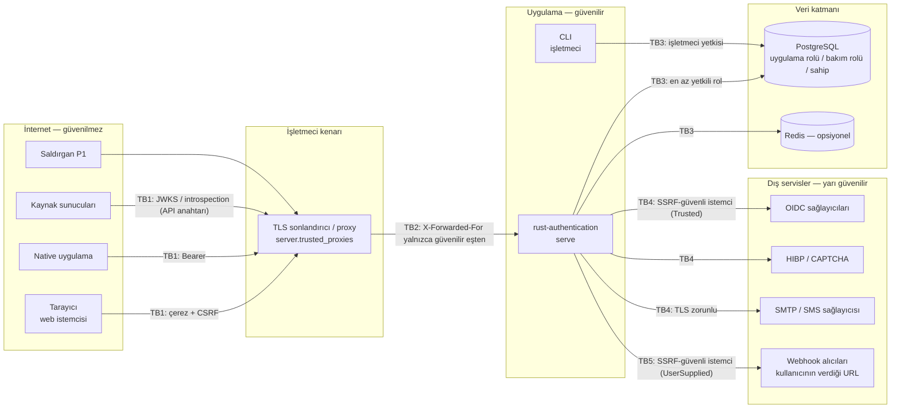

# Tehdit modeli (STRIDE, DOC-03)

> **Durum:** `claude/compassionate-darwin-aa1tiy` dalı, `47c84a7` (2026-11-05). Bu belge [K-57 modüller arası güvenlik denetiminin](k57-global-audit.md) §1 tehdit modelini **genişletir**, onunla çelişmez: saldırgan profilleri aynıdır (§3), buna varlıklar, güven sınırları ve bileşen başına STRIDE tablosu eklenir.
>
> Her azaltım bir koda ve gerçek bir test adına işaret eder (test adları `grep` ile doğrulandı). Kalan riskler [known-limitations.md](known-limitations.md)'de, kriptografi ayrıntıları [cryptography.md](cryptography.md)'de, OWASP ASVS eşlemesi [asvs-mapping.md](asvs-mapping.md)'de.

## 1. Kapsam ve varsayımlar

**Kapsamda:** `rust-authentication` binary'si (16 crate), PostgreSQL şeması ve rolleri, CLI, yapılandırma doğrulaması, giden HTTP/SMTP çağrıları.

**Kapsam dışı** (işletmecinin sorumluluğu, bu repoda doğrulanmadı):

- TLS sonlandırma (ters proxy / yük dengeleyici), ağ segmentasyonu, WAF.
- PostgreSQL'in kendisinin, işletim sisteminin ve konteyner çalışma ortamının sertleştirilmesi; disk şifreleme; yedeklerin korunması.
- Ön yüz uygulamaları (web, iOS, Android) ve onların XSS / token saklama güvenliği. Bu sistem API-önceliklidir; barındırılan UI yoktur.
- Faz 2/3 yüzeyinin henüz yazılmamış kısımları (kurumsal SSO, SCIM, DPoP, SAML ve OIDC sağlayıcısının K-80 "Kalan" maddeleri): kodda yok ([roadmap](../roadmap.md)). OIDC sağlayıcısının çekirdeği §5.7a'dadır.

**Varsayımlar:**

1. Sunucu bir TLS sonlandırıcının arkasında çalışır ve `server.public_base_url` üretimde `https`'dir. Üretim ortamında (`server.environment = "production"`) yapılandırma doğrulaması bunu zorlar (`crates/authn-core/src/config/mod.rs`, `validate_cross_section`).
2. `server.trusted_proxies` yalnızca gerçek proxy adreslerini içerir. Her adresi kapsayan ya da IPv4'te `/8`'den, IPv6'da `/16`'dan geniş önekler reddedilir (`prt_06_k57_catch_all_trusted_proxies_are_refused`, `prt_06_k57_near_catch_all_trusted_proxies_are_refused`).
3. Uygulama, [en az yetkili veritabanı rolüyle](../operations/least-privilege.md) bağlanır (OPS-10). Bu yapılmazsa §5.10'daki audit kurcalama azaltımlarının bir kısmı geçersizdir.
4. Kök sırlar (pepper, KEK, `hmac_root_key`) veritabanından ayrı tutulur (ortam değişkeni veya gizli dosya). KMS/HSM uygulaması yoktur (Faz 2, K-96).
5. Sistem saati NTP ile senkrondur (hız sınırı, TOTP, token ömürleri buna bağlıdır).

## 2. Varlıklar

| # | Varlık | Nerede | Gizlilik | Bütünlük | Erişilebilirlik |
|---|--------|--------|----------|----------|-----------------|
| A1 | Şifre hash'leri | `password_credentials` | Yüksek (çevrimdışı kırma) | Yüksek | — |
| A2 | Kök sırlar: pepper, KEK, `hmac_root_key` | Yapılandırma / ortam | **Kritik** | Kritik | Kritik (kaybı = tüm şifreli veri ve MAC'ler) |
| A3 | JWT imza anahtarları | `signing_keys` (zarf şifreli), süreç belleği | Kritik (sahte token) | Kritik | Yüksek |
| A4 | Oturum ve refresh token'ları | İstemcide; DB'de yalnızca SHA-256 | Yüksek | Yüksek | — |
| A5 | MFA sırları: TOTP sırrı, kurtarma kodları, güvenilir cihaz token'ları | `mfa_*` (TOTP zarf şifreli), HMAC'ler | Yüksek | Yüksek | Orta (kilitlenme) |
| A6 | Passkey açık anahtarları ve sayaçları | `webauthn_credentials` | Düşük | Yüksek (anahtar ekleme = arka kapı) | Orta |
| A7 | Tek kullanımlık token/kodlar (sıfırlama, doğrulama, magic link, davet) | `one_time_tokens` ve modül tabloları (hash) | Yüksek (hesap ele geçirme) | Yüksek | — |
| A8 | Sağlayıcı token'ları, Apple özel anahtarı, webhook sırları | Zarf şifreli kolonlar / yapılandırma | Yüksek | Yüksek | Orta |
| A9 | API anahtarları | `api_keys` (SHA-256) | Yüksek | Yüksek | — |
| A10 | Kişisel veri: e-posta, telefon, görünen ad, IP, user-agent | `users`, `user_profiles`, `audit_event_pii` vb. ([KVKK envanteri](../compliance/kvkk-gdpr.md)) | Yüksek (KVKK/GDPR) | Orta | — |
| A11 | Yetkilendirme durumu: üyelikler, roller, org politikaları, platform admin bayrakları | `memberships`, `roles`, `org_policies`, `users` | Orta | **Kritik** (ayrıcalık yükseltme) | — |
| A12 | Audit log'u ve zinciri | `audit_events`, `audit_chain_head`, kontrol noktaları | Orta | **Kritik** (inkâr edilemezlik) | Orta |
| A13 | Hesap varlığı bilgisi | Yanıtlar, durum kodları, süreler | Orta (numaralandırma) | — | — |
| A14 | Hizmetin erişilebilirliği | Argon2 CPU, DB havuzu, e-posta/SMS bütçeleri | — | — | Yüksek |

## 3. Saldırgan profilleri

K-57 §1 ile aynıdır; burada yalnızca STRIDE tablolarında kullanılan kısaltmalar eklenmiştir.

| Kısaltma | Saldırgan | Elinde ne var | Hedefi |
|----------|-----------|---------------|--------|
| P1 | Anonim internet | Hiçbir şey; istediği başlığı yazabilir | Hesap varlığı tespiti, kaba kuvvet, IP tabanlı sınırları aşmak, open redirect, CSRF |
| P2 | Kimliği doğrulanmış kullanıcı | Kendi oturumu (web veya native) | Ayrıcalık yükseltme, kendi organizasyonunun politikasını atlatmak |
| P3 | Başka kiracının org admini | Kendi org'unda `owner`/`admin` rolü | Kiracılar arası IDOR, başka org verisine erişim |
| P4 | Kötü niyetli OAuth/OIDC IdP | Yapılandırılmış bir sağlayıcının imza anahtarı | Rastgele adres için "doğrulanmış e-posta" iddiası, hesap birleştirme, MFA iddiası |
| P5 | Çalınmış refresh token | Bir native oturumun refresh token'ı | Kalıcı erişim, iptalden sonra kullanım |
| P6 | Çalınmış cihaz | Açık bir web oturumu, güvenilir cihaz çerezi | Step-up olmadan hassas işlem, MFA atlatma |
| P7 | Anahtarsız ele geçirilmiş uygulama DB rolü | Uygulama rolüyle SQL; KEK/pepper/HMAC kökü yok | Sır okuma, audit zincirini yeniden hesaplama, oturum üretme |
| P8 | Kötü niyetli personel admini | Platform admin oturumu | Tek başına yıkıcı işlem, iz bırakmadan impersonation |

Ek profiller (K-57'de ayrı satır olarak yoktu):

| Kısaltma | Saldırgan | Not |
|----------|-----------|-----|
| P9 | Posta kutusuna erişemeyen ama kurbanın adresini bilen kişi | Hesap ön-ele geçirme (pre-hijacking) sınıfı, [ADR 0002](../architecture/adr/0002-registration-pre-hijacking.md) |
| P10 | Ağ üzerinde konumlanmış saldırgan (giden çağrılar) | DNS rebinding, SSRF, SMTP düşürme |
| P11 | Sunucu sürecini ve sırlarını ele geçiren saldırgan | **Savunulamaz** sınıf; yalnızca tespit (dış audit çıpası) ve sonrası (anahtar rotasyonu) için önlem vardır |

## 4. Güven sınırları

| Sınır | Arasında | Ne geçer | Ana kontroller | Kod |
|-------|----------|----------|----------------|-----|
| TB1 | İstemci ↔ sunucu | HTTP istekleri, çerezler, Bearer token, API anahtarı | Host doğrulama, gövde/zaman/eşzamanlılık sınırı, güvenlik başlıkları, CORS, IP hız sınırı, kimlik doğrulama + CSRF (OPS-02 sırası) | `crates/authn-server/src/app.rs`, `crates/authn-protect/src/web/`, `crates/authn-session/src/middleware.rs` |
| TB2 | Proxy ↔ sunucu | İstemci IP'si iddiası (`X-Forwarded-For` / `Forwarded`) | Başlık yalnızca güvenilir eşten okunur, sağdan sola ilk güvenilmeyen hop alınır | `crates/authn-core/src/http/client_ip.rs` |
| TB3 | Sunucu/CLI ↔ veri katmanı | SQL | Yalnızca bind parametreli statik SQL (sqlx), en az yetkili roller, audit tablosunda `UPDATE`/`DELETE` yok | `migrations/2900_least_privilege.sql`, `2901_least_privilege_no_temp.sql` |
| TB4 | Sunucu ↔ yapılandırılmış dış servisler | ID token, JWKS, HIBP aralığı, CAPTCHA doğrulaması, e-posta, SMS | SSRF-güvenli `HttpClient` (`OutboundTarget::Trusted`), zaman aşımı, yanıt boyutu sınırı, yönlendirme izlenmez; SMTP'de TLS zorunlu | `crates/authn-protect/src/outbound/`, `crates/authn-notify/src/email/` |
| TB5 | Sunucu ↔ kullanıcının verdiği URL'ler | Webhook teslimleri | `OutboundTarget::UserSupplied`: yalnızca `https`, özel/yerel/metadata aralıkları reddedilir, çözümlenen IP'ye sabitlenir (DNS rebinding) | `crates/authn-protect/src/outbound/`, `crates/authn-audit/src/webhooks/` |
| TB6 | İşletmeci ↔ sunucu | Yapılandırma ve sırlar, CLI komutları | Açılışta hızlı başarısızlık, yayımlanmış örnek anahtarların üretimde reddi, CLI girdilerinin veritabanına dokunmadan doğrulanması | `crates/authn-core/src/config/`, `crates/authn-server/src/cli.rs` |
| TB7 | Kiracı ↔ kiracı | Org kapsamlı veriler | Tek yetkilendirme kapısı `authz::decide_access`; başka kiracının kaynağı `404` | `crates/authn-org/src/authz.rs` |
| TB8 | Personel ↔ kullanıcı | Admin işlemleri, impersonation | Passkey + step-up, IP izin listesi, gerekçe zorunlu, four-eyes, impersonation süreli ve varsayılan salt-okunur | `crates/authn-admin/src/guard.rs`, `crates/authn-admin/src/service/` |

## 5. Bileşen başına STRIDE

Gösterim: **S** kimlik sahteciliği, **T** kurcalama, **R** inkâr, **I** bilgi ifşası, **D** hizmet engelleme, **E** ayrıcalık yükseltme. "Kalan" sütunu [known-limitations.md](known-limitations.md)'deki ilgili maddeye işaret eder.

### 5.1 HTTP kenarı ve ara katman (`authn-server`, `authn-protect::web`)

| | Tehdit | Saldırgan | Azaltım (kod) | Test | Kalan |
|-|--------|-----------|---------------|------|-------|
| S | Sahte `X-Forwarded-For` ile IP tabanlı sınırları, org IP izin listesini, break-glass IP listesini atlatmak | P1 | Başlık yalnızca `trusted_proxies`'teki eşten; geniş önekler her ortamda reddedilir (`client_ip.rs`, `crates/authn-core/src/config/server.rs`) | `prt_06_untrusted_peer_ignores_forwarding_headers`, `prt_06_trusted_peer_uses_rightmost_untrusted_hop`, `prt_06_k57_near_catch_all_trusted_proxies_are_refused` | Proxy yanlış yapılandırılırsa (ör. tüm iç ağ güvenilir) yine sahte IP mümkündür |
| T | Host zehirlenmesi ile e-posta bağlantılarını saldırgana yönlendirmek | P1 | Host izin listesi, bilinmeyen host `421`; bağlantılar yalnızca `public_base_url`'den (`web/host.rs`, `authn-notify/src/links.rs`) | `prt_09_host_header_poisoning_is_refused`, `pwd_08_reset_email_never_depends_on_the_host_header` | — |
| T | CSRF / login CSRF | P1 | Çerezli her durum değiştiren istekte `Origin`/`Sec-Fetch-Site` + oturuma bağlı HMAC token; giriş öncesi ayrı token (`authn-session/src/csrf.rs`) | `ops_02_every_state_changing_route_is_behind_authentication_and_csrf`, `ses_04_state_changing_cookie_requests_need_origin_and_csrf_token`, `ses_01_web_login_requires_the_login_csrf_proof` | — |
| T | Open redirect (`return_to`, OIDC hata yönlendirmesi) | P1 | Tam eşleşme izin listesi, güvenli göreli yollar, `javascript:`/`data:` vb. şemalar reddedilir (`web/redirect.rs`) | `prt_10_open_redirect_tricks_are_rejected`, `prt_10_k58_script_and_document_schemes_are_never_redirect_targets`, `tst_02_social_return_to_cannot_open_redirect` | — |
| I | Yanıtlarda iç hata, sır veya hesap durumu | P1 | Kararlı hata kodları, iç ayrıntı yalnızca logda (`authn-core/src/error/`); `Cache-Control: no-store`, CSP, `nosniff` | `arc_08_internal_details_never_rendered`, `arc_08_foreign_errors_are_wrapped_without_leaking`, `prt_07_security_headers_on_every_response` | — |
| I | Kimlik bilgili isteklerde CORS ile veri okuma | P1 | Tam origin izin listesi; joker ve `null` açılışta reddedilir (`web/cors.rs`); impersonation başlığı yalnızca yapılandırılmış konsol origin'inden (`authn-server/src/cors.rs`) | `prt_08_other_origins_are_never_reflected_or_wildcarded`, `prt_08_wildcard_or_null_origins_are_refused_at_start_up` | — |
| D | Büyük gövde, yavaş istek, istek seli | P1 | Gövde sınırı (64 KiB), zaman aşımı, eşzamanlılık sınırı, IP başına hız sınırı (PRT-11, `app.rs`) | `prt_11_oversized_body_is_rejected_with_envelope`, `prt_04_http_layer_answers_429_with_retry_after` | HTTP katmanı hız sınırlayıcısı limiter hatasında açık başarısız olur (güvenlikle ilgili eylem limitleri kapalı) |
| E | Kimlik doğrulama katmanı dışında kalan bir modül rotası | P1 | Tüm modül rotaları kimlik doğrulama + CSRF katmanının içinde; tek istisna gözden geçirilmiş `SESSION_LESS` listesi | `ops_02_every_state_changing_route_is_behind_authentication_and_csrf`, `ops_02_account_admin_and_org_routes_refuse_anonymous_callers` | — |

### 5.2 Giriş akışları (`authn-session/src/login`, `authn-password`, `authn-protect::login`)

| | Tehdit | Saldırgan | Azaltım (kod) | Test | Kalan |
|-|--------|-----------|---------------|------|-------|
| S | Kaba kuvvet / credential stuffing | P1 | Her denemede bütçe önceden atomik tüketilir; hesap başına CAPTCHA eşiği, yumuşak kilit, IP başına sınır (`authn-protect/src/login.rs`) | `ses_01_concurrent_guesses_cannot_outrun_the_captcha_budget`, `prt_02_concurrent_attempts_cannot_outrun_the_failure_counters`, `prt_02_login_attempts_per_ip_are_limited_with_retry_after` | — |
| S | Bilinen şifreyle MFA'yı atlatmak | P1 | MFA politikası her giriş yolunda; challenge tek kullanımlık, deneme sınırlı, istemci türüne ve cihaza bağlı (`login/challenge.rs`) | `ses_02_challenge_is_single_use`, `ses_02_wrong_codes_burn_the_challenge`, `ses_02_challenge_is_bound_to_the_client_kind_and_device`, `ses_18_magic_link_still_requires_the_second_factor` | Challenge adımlarında paralel yanlış denemeler sınırı en fazla eşzamanlı istek sayısı kadar aşabilir |
| S | İzinli olmayan bir faktörle (ör. SMS yasaklı org, admin için TOTP) ikinci adımı geçmek | P2 | Faktör türü `allowed_factors` ile doğrulamadan **önce** süzülür | `ses_02_a_factor_outside_allowed_factors_is_refused_before_verification`, `ses_13_platform_admins_and_strict_orgs_need_a_passkey` | — |
| S | Yeni cihaz/ağdan riskli giriş | P1 | Risk değerlendirmesi: `medium` → MFA veya e-posta onayı, `high` → engel + bildirim | `rsk_03_high_risk_is_blocked_after_the_password_and_the_user_is_told`, `rsk_03_medium_risk_without_mfa_requires_an_email_confirmation` | Kural tabanlı; GeoIP uygulaması yok (Faz 2, K-98) |
| T | `must_change_password` bayrağını atlatmak | P2 | Sonuç `enum` ile eşlenir; `MustChangePassword` yalnızca zorunlu adım verir | `ses_22_must_change_password_is_a_required_action`, `pwd_12_must_change_password_is_reported_after_a_correct_password` | — |
| R | Başarısız ya da başarılı girişin izsiz kalması | P1, P2 | `login.succeeded/failed` olayları neden koduyla; break-glass girişi yüksek öncelikli olay | `aud_01_every_security_event_kind_is_recordable_and_duplicates_are_ignored`, `adm_05_break_glass_login_emits_high_priority_event` | — |
| I | Hesap varlığının gövde, durum kodu ya da **süreden** öğrenilmesi | P1 | Aynı `invalid_credentials`; hesap yoksa sahte Argon2 doğrulaması; hesap durumu yalnızca doğru şifreden sonra | `ses_01_every_credential_failure_is_identical`, `ses_01_unknown_account_takes_as_long_as_a_wrong_password`, `ses_01_account_status_is_revealed_only_after_a_correct_password`, `prt_03_lock_response_does_not_reveal_account_existence` | Eski bcrypt/PBKDF2 hash'li hesaplarda süre farkı (göç tamamlanana dek) |
| D | Kurbanın hesabını kilitlemek | P1 | Yumuşak kilit yalnızca bilinmeyen cihazdan **şifre** denemelerini engeller; passkey, güvenilir/bilinen cihaz ve sıfırlama çalışır | `prt_03_soft_lock_blocks_only_untrusted_password_attempts` | Hedefli yumuşak kilit (bilinmeyen cihazdan şifreli giriş) tasarım gereği mümkündür |
| D | Argon2 ile CPU ve bağlantı havuzunu tüketmek | P1 | Semafor (`max_concurrent_hashes`, `crates/authn-crypto/src/password/mod.rs`), IP hız sınırı, eşzamanlılık sınırı; giriş hattı yavaş iş sırasında ikinci havuz bağlantısı beklemez | `arc_12_hashing_concurrency_is_bounded_by_the_semaphore`, `ses_01_concurrent_logins_never_starve_the_connection_pool` | — |

### 5.3 Oturumlar ve token'lar (`authn-session/src/service`, `authn-crypto::jwt`)

| | Tehdit | Saldırgan | Azaltım (kod) | Test | Kalan |
|-|--------|-----------|---------------|------|-------|
| S | Oturum sabitleme | P1 | Her girişte, MFA'da, org değiştirmede, step-up'ta yeni token; `__Host-` çerezi dışarıdan yazılamaz | `ses_03_cookie_authenticates_and_every_login_gets_a_fresh_session`, `ses_13_password_step_up_refreshes_auth_time_and_rotates_the_session`, `ses_17_switching_to_a_member_org_rotates_the_session` | — |
| S | Sahte JWT (`alg` karışıklığı, `none`, yanlış `kid`) | P1 | Sabit EdDSA, katı ayrıştırıcı, `verify_strict` ([ADR 0001](../architecture/adr/0001-jwt-implementation.md)) | `cry_09_alg_none_and_symmetric_algorithms_are_rejected`, `cry_09_structural_attacks_are_rejected`, `cry_09_forged_tokens_are_refused_through_the_stack` | — |
| S | Çalınmış refresh token | P5 | Her kullanımda rotasyon; yeniden kullanımda tüm aile iptal + güvenlik olayı; eşzamanlı refresh de yeniden kullanım sayılır | `ses_05_refresh_rotates_and_replay_revokes_the_family`, `ses_05_concurrent_refresh_of_one_token_is_a_replay`, `tst_06_native_refresh_rotation_and_reuse_detection` | Token gönderene bağlı değil (DPoP yok, Faz 2 K-81) |
| S | İptal edilmiş oturumun access token'ının kullanılması | P5, P6 | Her Bearer isteğinde canlı oturum kontrolü; üretimde kapatılamaz | `ses_05_revoked_session_rejects_its_access_tokens_at_once`, `ses_08_k58_session_check_cannot_be_switched_off_in_production_or_staging` | `production` dışı ortamlarda kapatılırsa iptal gecikmesi ≤ `access_token_ttl` |
| E | Çalınmış oturumla hassas işlem | P6 | Step-up: son N dakikada yeniden doğrulama; platform admini ve katı org'lar için passkey | `ses_13_step_up_window`, `ses_13_platform_admins_and_strict_orgs_need_a_passkey`, `pwd_06_change_without_current_password_requires_recent_step_up` | MFA'lı normal kullanıcıda step-up şifreyle yapılabilir (SES-13) |
| E | Eski access token'la yetki değişikliği (org değiştirme, step-up) yaparak yeni refresh token almak | P5 | Refresh token ↔ access token `jti` eşlemesi; eşleşmeyen token `401` alır, hiçbir şey dönmez | `ses_05_k58_privilege_change_after_a_refresh_with_the_old_access_token_is_refused`, `ses_13_k58_overtaken_privilege_change_is_refused_not_a_replay` | — |
| E | Org politikasını (giriş yöntemi, izinli faktör) org'u etkinleştirmeden atlatmak | P2 | `Principal.login_method` / `mfa_factors` her org isteğinde `OrgPolicy::check_session_methods` ile (K-57 F2) | `org_07_k57_login_method_policy_applies_to_personal_context_sessions`, `org_07_k57_allowed_factor_policy_applies_to_personal_context_sessions`, `org_07_k57_bearer_token_does_not_inherit_factors_of_a_later_step_up` | — |
| R | Oturum iptallerinin izsiz kalması | P2 | `session.revoked`, `session.revoked_bulk`, `session.refresh_token_reused` olayları | `ses_15_org_scoped_revocation_and_domain_events` | — |
| I | Token'da kişisel veri | P1 | Access token'da e-posta/ad yok; IP oturum listesinde maskeli | `ses_08_access_token_claims_follow_rfc_9068_without_personal_data`, `ses_11_session_list_masks_ip_and_marks_the_current_session` | — |
| D | Acil iptal edilen imza anahtarının diğer instance'larda doğrulamaya devam etmesi | P1 | `signing_keys` tetikleyicisi + `LISTEN/NOTIFY` ile önbellek anında boşaltılır | `ses_09_k58_serving_instance_drops_a_key_revoked_elsewhere`, `ses_09_k58_listener_survives_a_killed_connection` | Dinleyici çalışmıyorsa en çok `signing_key_cache_ttl` |

### 5.4 Hesap yaşam döngüsü (`authn-account`)

| | Tehdit | Saldırgan | Azaltım (kod) | Test | Kalan |
|-|--------|-----------|---------------|------|-------|
| S | Hesap ön-ele geçirme ("saldırgan önce", "saldırgan ikinci") | P9 | Kayıt kimlik bilgisi yazmaz; her kayıt link + tutamaç/şifreye bağlı ([ADR 0002](../architecture/adr/0002-registration-pre-hijacking.md)) | `acc_02_attacker_first_link_alone_never_activates_the_attackers_password`, `acc_02_attacker_second_cannot_overwrite_or_inherit_the_victims_registration`, `acc_02_k58_a_link_never_completes_a_registration_of_another_account` | Kod oltalaması (ADR 0002 "Artık riskler") |
| S | E-posta değişikliğiyle hesabı ele geçirmek | P2, P9 | Step-up; yeni adrese doğrulama oturuma bağlı; eski adrese geri alma bağlantısı; geri alma saldırganın eklediği tüm giriş yöntemlerini siler (K-20) | `acc_07_email_change_requires_step_up`, `acc_07_email_change_link_requires_the_account_holders_session`, `acc_07_k20_revert_removes_every_login_method_the_attacker_added` | — |
| T | Durum makinesinde geçersiz geçiş | P2 | Geçişler tek fonksiyonda; geçersiz geçiş reddedilir ve yazılmaz | `acc_06_forbidden_transitions_are_rejected_and_not_written`, `acc_06_every_transition_is_audited_with_from_and_to` | — |
| I | Kayıtta hesap varlığı | P1 | Aynı durum, gövde ve süre; hesaba bağlı iş arka planda | `acc_02_existing_address_gets_identical_status_and_body`, `acc_02_signup_timing_does_not_reveal_existing_accounts` | — |
| I | Dışa aktarmada sır | P2 | Modüller `DataExporter` ile yalnızca sırsız bölümler ekler | `acc_10_export_contains_every_registered_section_and_no_secrets`, `mfa_10_data_export_contains_no_secrets` | — |
| D | Hedefli kayıt DoS'u, e-posta bombalama | P1 | Adres başına bildirim bütçesi aşılsa da kayıt saklanır; alıcı başına bildirim sınırı | `acc_02_k58_exhausted_email_budget_never_drops_the_owners_registration`, `acc_02_registration_notices_are_throttled_per_address` | Hesap başına 10 canlı kayıt sınırı (ADR 0002) |

### 5.5 Şifre yönetimi ve sıfırlama (`authn-password`)

| | Tehdit | Saldırgan | Azaltım (kod) | Test | Kalan |
|-|--------|-----------|---------------|------|-------|
| S | Sıfırlama token'ını tahmin etmek / tekrar kullanmak | P1 | 256 bit token, yalnızca hash, tek kullanımlık, 30 dk; yeni istek eskileri iptal eder | `pwd_07_reset_token_is_256_bit_single_use_and_only_its_hash_is_stored`, `pwd_09_concurrent_link_consumption_has_exactly_one_winner`, `pwd_07_new_request_revokes_previous_link_and_code` | — |
| S | 6 haneli sıfırlama kodunu tahmin etmek | P1 | Kod başına 5 deneme, adres/IP başına sınır | `pwd_08_code_attempts_are_limited_then_the_code_is_burned` | ≈ 10⁻⁵/saat/hesap; `password.reset.code_enabled = false` ile kapatılabilir |
| E | Sıfırlama ile MFA'yı atlatmak | P1 | Sıfırlama oturum açmaz; tüm oturumlar, refresh token'lar ve güvenilir cihazlar iptal; sonraki giriş yine MFA ister | `pwd_09_reset_endpoint_replaces_the_password_without_issuing_a_session`, `pwd_09_reset_revokes_every_session_refresh_token_and_trusted_device`, `tst_06_password_reset_ends_every_session_and_trusted_device` | — |
| I | Sıfırlamada hesap varlığı | P1 | Her durumda aynı yanıt; bilinmeyen hesaplar için de aynı hız sınırı ve audit işi | `pwd_07_forgot_answers_identically_for_known_and_unknown_accounts`, `pwd_08_code_failures_do_not_reveal_whether_the_account_exists`, `pwd_08_unknown_address_code_failures_do_the_same_audit_work` | — |
| I | Şifrenin loglara girmesi | — | Şifre tipleri `Debug`'da redakte; log yakalama testi | `pwd_05_passwords_tokens_and_codes_never_appear_in_logs` | — |
| D | Kurbanın sıfırlama bütçesini tüketmek | P1 | Adrese bağlı sınır zorunlu (varlık sızmasın); kod yanınca link geçerli kalır | `pwd_07_requests_are_rate_limited_per_email_and_per_ip_alike_for_unknown_accounts` | Hedefli sıfırlama DoS'u kabul edilen risk |

### 5.6 MFA ve passkey (`authn-mfa`, `authn-webauthn`)

| | Tehdit | Saldırgan | Azaltım (kod) | Test | Kalan |
|-|--------|-----------|---------------|------|-------|
| S | TOTP tekrar kullanımı | P1 | Son kullanılan adım saklanır; satır kilidi altında | `mfa_02_totp_code_cannot_be_replayed`, `mfa_02_concurrent_duplicate_submissions_only_one_succeeds` | — |
| S | OTP kaba kuvveti | P1 | Faktör ve kullanıcı başına sayaç, geçici kilit, güvenlik olayı | `mfa_03_factor_locks_after_max_failures_with_security_event`, `mfa_03_concurrent_wrong_guesses_are_counted_exactly` | Şifreyi bilen saldırgan kullanıcının MFA'sını 15 dk geciktirebilir |
| S | Phishing ile passkey kullanımı | P1 | Origin tam eşleşme, RP ID kontrolü (`webauthn-rs`); kardeş alt alan adı reddedilir | `pky_01_assertion_from_wrong_origin_is_rejected`, `pky_06_origins_must_belong_to_the_rp_id_or_be_related` | — |
| S | Klonlanmış authenticator | P1 | İmzalı onayda sayaç gerilemesi → işaret + olay + bildirim | `pky_05_counter_regression_flags_a_cloned_passkey`, `pky_05_clone_suspicion_notifies_the_owner_once` | Klon şüpheli passkey kullanılmaya devam eder (karar kullanıcıda) |
| T | Saldırganın kalıcı arka kapı olarak faktör/passkey eklemesi | P6, P8 | Ekleme step-up ister; impersonation'da passkey eklenemez; ekleme bildirilir | `mfa_07_factor_changes_require_step_up_and_a_real_session`, `pky_01_impersonation_never_registers_a_passkey`, `pky_01_step_up_is_required_to_add_passkeys` | Step-up şifreyle yapılabildiğinden çalınmış çerez + şifre ile faktör eklenebilir (kullanıcı bildirilir) |
| E | Son faktörü/girişi silerek hesabı MFA'sız bırakmak | P2 | `users` satır kilidi altında "son faktör / son yöntem" kuralları, modüller arası yarışlar dahil | `mfa_07_concurrent_removal_of_the_last_two_factors_keeps_one`, `mfa_07_k69_concurrent_last_totp_and_last_passkey_removal_keep_a_factor`, `pwd_11_k69_cross_module_last_login_method_races_keep_one_method` | — |
| I | MFA sırlarının ifşası | P7 | TOTP sırrı zarf şifreli (AAD satıra bağlı); kurtarma kodları anahtarlı HMAC; yanıtlar ve dışa aktarma sırsız | `mfa_01_secret_is_envelope_encrypted_and_bound_to_its_row`, `mfa_04_hash_is_keyed_and_bound_to_the_user`, `mfa_10_status_lists_factors_without_secrets` | — |
| D | SMS pumping | P1 | Ülke izin listesi, numara/IP/kullanıcı sınırı, global günlük bütçe | `mfa_06_pumping_protection_per_number_ip_and_global_budget` | — |

### 5.7 Sosyal giriş (`authn-oidc-client`)

| | Tehdit | Saldırgan | Azaltım (kod) | Test | Kalan |
|-|--------|-----------|---------------|------|-------|
| S | Sahte ID token, algoritma karışıklığı, başka kiracı | P1, P4 | Algoritma izin listesi, `iss`/`aud`/`azp`/`exp`/`nonce`, Microsoft kiracı kuralı (`id_token.rs`) | `soc_03_alg_none_hmac_confusion_and_foreign_keys_are_rejected`, `soc_03_microsoft_tenant_spoofing_and_allow_list`, `soc_04_nonce_is_mandatory_single_use_and_provider_bound` | — |
| S | Doğrulanmamış e-posta iddiasıyla hesap birleştirme | P4 | Eşleştirme `(provider, subject)` ile; e-postayla otomatik birleştirme varsayılan kapalı; genel sağlayıcıların `email_verified`'ı varsayılan güvenilmez | `soc_05_identity_is_matched_by_subject_not_by_email`, `soc_05_existing_account_is_never_merged_automatically_by_default`, `soc_05_generic_provider_email_is_unverified_unless_trusted` | Güvenilir sayılan kötü niyetli IdP hesap varlığını öğrenebilir (K-57 §4) |
| S | Sağlayıcının MFA iddiasına güvenmek | P4 | `trust_provider_mfa` varsayılan kapalı; `amr` `primary_amr` ile süzülür | `ses_15_primary_authentication_cannot_claim_mfa_or_passkey_amr` | — |
| T | OAuth `state` tekrar, CSRF, PKCE atlatma | P1 | Sunucu tarafı tek kullanımlık state (10 dk), tarayıcı bağlama çerezi, PKCE S256 | `soc_02_state_replay_is_rejected`, `soc_02_callback_from_another_browser_is_rejected`, `soc_02_pkce_verifier_is_bound_to_its_state_row` | — |
| E | İptal edilmiş oturumla kimlik bağlamak | P6 | Callback'te başlatan oturum yeniden doğrulanır (K-03) | `soc_06_link_callback_rejects_revoked_session` | — |
| D | Sağlayıcı JWKS kesintisi | P10 | Üstel geri çekilme, azami bayatlık sonrası kapalı başarısızlık | `soc_03_jwks_outage_backs_off_exponentially`, `soc_03_k61_stale_keys_expire_after_the_max_staleness` | 24 saatten uzun kesintide o sağlayıcıyla giriş durur |

### 5.7a OAuth 2.1 / OIDC sağlayıcısı (`authn-oidc-provider`, K-80)

Yeni güven sınırı: kayıtlı **istemci uygulamalar** (RP) ve onların tarayıcı yönlendirmeleri. Sağlayıcı varsayılan kapalıdır (`oidc_provider.enabled`).

| | Tehdit | Saldırgan | Azaltım (kod) | Test | Kalan |
|-|--------|-----------|---------------|------|-------|
| S | Açık yönlendirme / kod hırsızlığı için sahte `redirect_uri` (alt yol, büyük/küçük harf, port, sorgu varyantı) | P1 | Kanonik kayıt, birebir eşleşme, yalnızca loopback portu serbest; doğrulanamayan istek yönlendirilmez (`redirect.rs`, `request.rs`) | `oidp_02_exact_match_rejects_variants`, `oidp_02_unregistered_redirects_are_never_followed`, `oidp_02_loopback_ignores_only_the_port` | — |
| S | Kod enjeksiyonu / çalınan kodun kullanımı | P1 | PKCE `S256` zorunlu (`plain` yok); kod istemciye, `redirect_uri`'ye, doğrulayıcıya bağlı; yanlış doğrulayıcı kodu yakar | `oidp_03_missing_and_plain_pkce_are_redirected_errors`, `oidp_06_code_is_bound_to_client_redirect_verifier_and_lifetime` | — |
| S | Mix-up saldırısı (RP birden çok sağlayıcıyla) | P1 | Her yetkilendirme yanıtında RFC 9207 `iss` (hata yönlendirmeleri dahil), keşifte ilan | `oidp_06_web_client_code_flow_with_pkce_and_independent_id_token_check`, `oidp_03_missing_and_plain_pkce_are_redirected_errors` | RP'nin `iss`'i doğrulaması gerekir (rehber) |
| T | Kod / refresh token tekrarı | P1, P2 | Tek kullanımlık kod, tekrarında grant ve tüm token'ları iptal; refresh rotasyonu, tekrarında grant iptali (`service/token.rs`) | `oidp_06_code_replay_revokes_every_token_of_the_grant`, `oidp_07_refresh_rotation_and_replay_detection` | Yerelde JWT doğrulayan kaynak sunucusu iptali `access_token_ttl` (5 dk) sonra görür |
| E | Token türü karışıklığı (sağlayıcı token'ı native API'de veya tersi) | P1, P2 | Sağlayıcı access token'ında `sid` yok, `aud` native kitleleri asla içermez (kayıt ve imzada denetim); sağlayıcı yalnızca `jti` kaydı olan token'ı kabul eder; protokol uçları native ara katmanın dışında | `oidp_08_provider_and_native_tokens_are_never_interchangeable`, `oidp_08_foreign_shaped_tokens_are_rejected_by_userinfo` | — |
| E | Onay atlatma / consent phishing (saldırganın başlattığı isteği kurbana onaylatmak) | P1 | Etkileşim tarayıcıya bağlı (`__Host-` çerezi hash'i), tek kullanımlık, 10 dk; onay oturum + CSRF arkasında; impersonation oturumu yetkilendiremez | `oidp_04_interaction_without_session_then_login_then_accept`, `oidp_04_deny_and_impersonation` | Onay ekranının çerçeve koruması işletmecinin önyüzünde (rehber) |
| E | Oturum bitince RP erişiminin sürmesi (şifre sıfırlama, her yerden çıkış, askı, silme) | P2 | Grant oturuma bağlı, her kullanımda canlılık denetimi (`SessionLiveness`); silmede kaskad | `oidp_12_sign_out_everywhere_ends_provider_grants`, `oidp_12_password_reset_and_suspension_end_provider_grants`, `oidp_12_account_deletion_removes_grants` | — |
| E | Yetkisiz personelin istemci kaydetmesi / sır çalması | P6 | `oauth_clients:read` / `:manage` rolleri (K-93) + ADM-01 guard; sır yalnızca SHA-256, bir kez gösterilir, audit'te yok | `oidp_01_client_registry_follows_staff_roles`, `oidp_01_client_registry_is_staff_only_and_validated` | — |
| I | Başka istemcinin token'ını introspection ile okumak | P1 | Introspection yalnızca gizli istemci; token yalnızca kendi istemcisine / `aud`'undakine aktif | `oidp_11_revocation_and_introspection` | — |
| D | Yetkilendirme / token uçlarının sele boğulması | P10 | IP ve istemci başına rate limit, ayrıştırıcı boyut sınırları (fuzz hedefi `oidc_authorize_request`) | `oidp_12_rate_limits_apply_to_authorize_and_token` | — |

### 5.8 Organizasyonlar ve yetkilendirme (`authn-org`)

| | Tehdit | Saldırgan | Azaltım (kod) | Test | Kalan |
|-|--------|-----------|---------------|------|-------|
| S | Çalınmış API anahtarı | P1 | Yalnızca hash saklanır; kapsam, zorunlu son kullanma, org'a bağlı; hatalar tek tip `401` ve hız sınırlı | `org_08_api_keys_are_limited_by_scopes_and_bound_to_their_org`, `org_08_every_failure_is_the_same_401_and_failures_are_limited`, `org_08_expiry_is_mandatory_and_bounded` | Kişisel API anahtarlarına org MFA/ömür politikası uygulanmaz |
| T | Başka org'un kimliklerini referans olarak kullanmak | P3 | Org kapsamlı her sorgu `org_id` filtreli; şema kısıtları | `arc_10_org_10_foreign_ids_cannot_be_used_as_references`, `arc_10_custom_role_of_another_org_cannot_be_assigned` | — |
| I | Kiracılar arası IDOR | P3 | Tek kapı `authz::decide_access`; başka kiracının kaynağı `404` | `arc_10_org_10_every_endpoint_hides_other_tenants_from_a_session_owner`, `org_10_api_keys_and_service_accounts_are_confined_to_their_org` | — |
| E | Ayrıcalık yükseltme (rol atama, owner) | P2 | Kullanıcı sahip olmadığı izni içeren rolü atayamaz; `owner`'ı yalnızca `owner` atar; varsayılan reddet | `org_04_custom_role_with_permissions_the_actor_lacks_cannot_be_granted`, `org_04_admins_cannot_grant_owner_or_manage_owners`, `org_03_default_deny_and_role_permissions` | — |
| E | Kendini politika dışında bırakan politika (kilitlenme) | P2 | `update_policy` çağıranın oturumunu dışarıda bırakan değişikliği reddeder | `org_07_k57_policy_change_refuses_to_forbid_the_callers_login_method` | — |
| R | Politika ve üyelik değişikliklerinin izsiz kalması | P2, P3 | `org.policy_changed`, `org.member_*` olayları | `aud_04_org_audit_log_filters` | — |

### 5.9 Yönetim (`authn-admin`, CLI)

| | Tehdit | Saldırgan | Azaltım (kod) | Test | Kalan |
|-|--------|-----------|---------------|------|-------|
| S | Admin oturumunun ele geçirilmesi | P1 | Admin uçları passkey `amr`'si, son 10 dk step-up ve opsiyonel IP izin listesi ister | `adm_01_rejects_admin_without_passkey_amr`, `adm_01_rejects_admin_without_recent_step_up`, `adm_01_rejects_ip_outside_allow_list` | — |
| T | Tek bir kötü niyetli admin tarafından toplu yıkıcı işlem | P8 | Four-eyes: acil durum ve admin hedefli işlemler ikinci adminin onayını ister; onay tek kullanımlık ve parametre hash'ine bağlı; üretimde kapatılamaz | `adm_06_k66_emergency_needs_an_approval_and_uses_it_once`, `adm_06_k66_parameter_tampering_is_refused`, `adm_06_k66_four_eyes_cannot_be_switched_off_in_production` | Break-glass ve tek adminli kurulum için tanımlı, audit'li istisna |
| R | Personel işleminin izsiz/gerekçesiz kalması | P8 | Her admin işlemi gerekçe ister; gerekçe ve olay aynı transaction'da; gerekçeler ekleme-yalnızca | `adm_08_every_action_requires_a_valid_reason`, `adm_08_impersonation_reason_and_event_commit_atomically`, `adm_08_justifications_are_append_only` | — |
| I | Impersonation ile kullanıcı verisine sınırsız erişim | P8 | Süreli (varsayılan 15 dk, en çok 60), varsayılan salt-okunur, `act` claim'i, kullanıcıya bildirim, adminlere/break-glass'a uygulanamaz, admin askıya alınınca biter | `adm_04_defaults_read_only_fifteen_minutes_with_admin_session`, `adm_04_not_applicable_to_admins_break_glass_self_or_inactive`, `ses_15_impersonation_ends_when_the_admin_is_revoked_demoted_or_suspended` | — |
| E | API üzerinden admin yetkisi kazanmak | P2, P8 | Admin yetkisi API'den verilemez; yalnızca çevrimdışı CLI (`grant-admin`), gerekçe + operatör zorunlu | `adm_05_k76_cli_grant_and_revoke_admin`, `adm_05_k76_concurrent_revocations_leave_an_admin` | CLI'a ve veritabanına erişen işletmeci güvenilir kabul edilir |
| D | Admin hedefli işlemleri tekrarlayarak kesinti | P8 | Ayrı sıkı limitler, soğuma süresi, four-eyes | `adm_06_k66_approval_requests_are_capped_per_requester` | — |

### 5.10 Audit, outbox, webhook'lar, bildirimler (`authn-audit`, `authn-notify`)

| | Tehdit | Saldırgan | Azaltım (kod) | Test | Kalan |
|-|--------|-----------|---------------|------|-------|
| T | Audit kayıtlarını değiştirmek/silmek | P7 | Uygulama rolünde `UPDATE`/`DELETE` yok + tetikleyici; eşzamanlı yazımda zincir çatallanmaz | `aud_02_append_only_trigger_refuses_update_delete_and_truncate`, `aud_02_least_privilege_roles_cannot_rewrite_history`, `aud_02_concurrent_writers_never_fork_the_chain` | — |
| T | Zinciri anahtarsız yeniden hesaplamak, sahte olay eklemek | P7 | Anahtarlı HMAC zinciri (K-77); geri düşüş tespiti | `k_77_forger_without_the_key_cannot_recompute_the_chain`, `k_77_downgrading_keyed_events_to_the_unkeyed_rule_is_detected` | Sondan kesme / geri sarma yalnızca dış çıpayla; tüm zinciri eski biçime çevirmek yalnızca `legacy_until_seq` sabitlemesiyle yakalanır |
| R | Kullanıcının/personelin işlemini inkâr etmesi | P2, P8 | Olayda aktör + impersonation durumunda gerçek aktör, istek kimliği, IP özeti | `aud_03_impersonation_records_the_real_actor`, `aud_01_record_persists_event_with_pseudonyms_and_pii` | Sunucu süreci ele geçirilirse (P11) yazdıkları ayırt edilemez |
| I | Audit metadata'sında sır veya kişisel veri | — | Sanitizer anahtar ve değer sezgileriyle redakte eder; kişisel veri zincir dışında | `aud_03_secrets_and_personal_data_never_reach_the_database`, `aud_03_secret_and_pii_values_are_redacted_whatever_the_key` | Sezgiler her sırrı yakalayamaz (nötr anahtar altında düz şifre) |
| I | Silinen kullanıcının izlerinin kalması | — | Takma ad eşlemesi silinir; outbox ve webhook geçmişi karartılır | `aud_05_pseudonymize_subject_removes_pii_and_keeps_the_chain_intact`, `aud_05_k58_erasure_scrubs_the_outbox_and_redacts_the_webhook_history` | Başka bir kullanıcının olay `data`'sındaki kimlik saklama süresi boyunca kalabilir |
| E | Webhook URL'siyle SSRF / iç ağa erişim | P2, P3 | Yalnızca `https` ve genel adresler; DNS sabitleme; yönlendirme izlenmez | `prt_12_webhook_delivery_refuses_a_name_rebound_to_loopback`, `tst_02_webhook_urls_cannot_target_internal_services`, `prt_12_redirects_are_not_followed` | — |
| S | E-posta başlık enjeksiyonu, SMTP düşürme | P1, P10 | Ad/konu alanlarında CRLF reddi; STARTTLS/TLS zorunlu, düz metne düşmez, sunucu sertifikası doğrulanır | `ntf_03_headers_cannot_be_injected_through_subject_or_name`, `ntf_03_smtp_never_falls_back_to_plain_text`, `ntf_03_smtp_rejects_untrusted_server_certificates` | — |
| D | Bildirimlerle posta kutusu bombalama | P1 | Alıcı başına tür bütçesi | `acc_02_registration_notices_are_throttled_per_address` | Kurbanın bir türdeki bütçesi tüketilebilir |

### 5.11 Anahtarlar, yapılandırma ve veritabanı (`authn-crypto`, `authn-store`, `authn-core::config`)

| | Tehdit | Saldırgan | Azaltım (kod) | Test | Kalan |
|-|--------|-----------|---------------|------|-------|
| I | Veritabanı sızıntısından sırların okunması | P7 | Token/kod/anahtar yalnızca hash; sırlar zarf şifreli, AAD satıra bağlı; şifreler Argon2id + pepper | `cry_08_aad_binds_table_column_and_row`, `cry_02_the_pepper_is_part_of_the_hash`, `aud_07_create_returns_the_secret_once_and_stores_only_ciphertext` | Kişisel veri (e-posta, telefon) kolon düzeyinde şifreli değil |
| T | Uygulama rolüyle şema/rol ele geçirme (`pg_temp`, `search_path`) | P7 | En az yetki fonksiyonu tehlikeli rolleri reddeder, `TEMPORARY` geri alınır, çağıranın `search_path`'ine güvenilmez | `ops_10_restricted_roles_cannot_create_temporary_objects`, `ops_10_least_privilege_helper_ignores_the_callers_search_path`, `k_77_switch_trigger_cannot_be_hijacked_through_pg_temp` | Rolleri kurmak işletmecinin işidir (runbook) |
| S | Örnek/test anahtarlarıyla üretime çıkmak | — | Yayımlanmış anahtarlar `production`/`staging`'de reddedilir | `cry_02_published_keys_are_refused_in_production`, `ops_08_example_keys_are_refused_in_production` | — |
| T | Güvensiz yapılandırma (bellek içi hız sınırı, SSRF muafiyeti, four-eyes kapalı, oturum kontrolü kapalı) | — | `production` ortamında yapılandırma doğrulaması reddeder; servis açılmaz | `ses_08_k58_session_check_cannot_be_switched_off_in_production_or_staging`, `adm_06_k66_four_eyes_cannot_be_switched_off_in_production`, `prt_05_k58_captcha_hostnames_are_required_in_production` | `staging` de aynı kuralları uygular (K-111); yalnızca `admin.four_eyes = false` ve `notify.email.transport = "disabled"` izinlidir |
| I | Sırların loglara/`Debug`'a girmesi | — | `secrecy`/`Zeroizing`, redakte eden `Debug`, log yakalama testleri | `cry_13_debug_output_contains_no_secrets`, `k_77_chain_key_never_appears_in_logs_or_debug`, `arc_07_invalid_values_are_all_reported_without_secrets` | Üçüncü taraf kütüphanelerin (zxcvbn, serde/axum tamponları, lettre) iç kopyaları sıfırlanmaz |
| E | Kod enjeksiyonu (SQL) | P1 | Yalnızca `&'static str` SQL + bind parametreleri (sqlx 0.9); dinamik SQL derlenmez | Mimari kural, `CLAUDE.md` / `contracts.md` | — |

## 6. Kalan riskler ve sonraki adımlar

- Kabul edilen ve gerekçelendirilen tüm riskler tek listede: [known-limitations.md](known-limitations.md).
- Bu model bir **iç** değerlendirmedir. Üretimden önce bağımsız bir dış pentest önerilir (K-72, proje sahibinin kararı).
- Faz 2 bileşenleri (OIDC sağlayıcısı, SSO, SCIM, DPoP) eklendiğinde her biri bu belgeye kendi STRIDE tablosuyla eklenmeli ve K-57'deki "her org isteğinde politika" kuralını izlemelidir.
